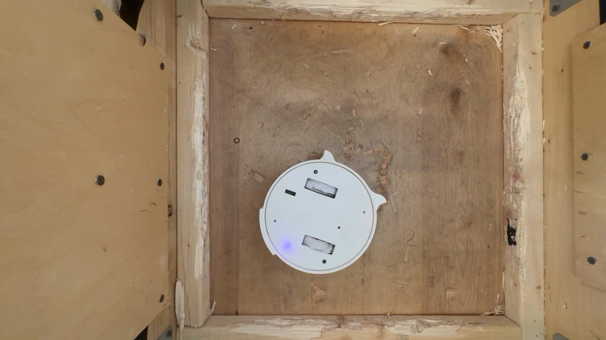

# 2026APLANT
Robot and Controller Code for "Roomba of Death" competing at  WPI's 2026 A-Term Plastic Antweight combat competition

## Roomba of Death
Roomba of Death is a double ring spinner combat robot. The regular weight for one robot in the antweight weight class is 1lb, but roomba of death gets a 0.5lbs weight bonus due to unconventional control in this case being text input.

## How it works
Robot has esp32 set up as a WiFi access point and communicates with the controller using UDP, the controller pings the robot to keep the connection alive, if the robot does not receive any pings for a certain amount of time it get recognized as a disconnect and stops everything, as specified in the rules.

## Problems
There is a considerable delay between sending the input and the robot executing it, one match was lost due to input difficulty making it not move for 10 seconds (knockout) the other match was lost in Judges decision. Easier drive could've made us win both matches.

The other problem was the weapons only working for a couple of seconds before the o-ring driving them would disintegrat
e.

Going forward I will not utilize the unconventional control weight bonus as it proved to be too much of a disadvantage.
